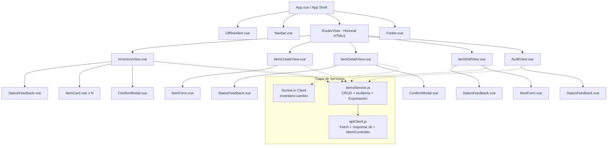
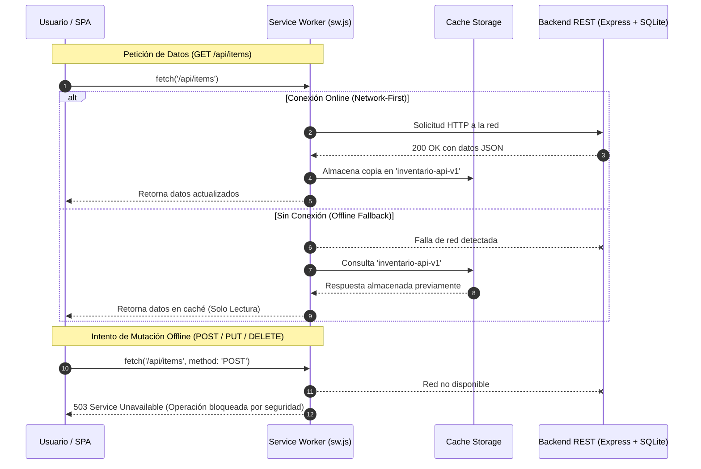

# INFORME TÉCNICO: APLICACIÓN SPA / PWA CON VUE 3 Y CONSUMO DE API REST
**Asignatura:** Programación Web • **Unidad:** 3 • **Estudiante:** Alex Palma  
**Proyecto:** Sistema de Gestión de Inventario con Soporte PWA y Sincronización en Tiempo Real  

---

## 1. Arquitectura de Componentes y Estado

La solución se diseñó bajo el patrón de **Arquitectura Desacoplada por Componentes** de Vue 3 (Composition API con `<script setup>`), separando estrictamente la lógica de negocio y consumo de red (**Smart Views**) de la presentación pura (**Dumb Components**). La comunicación se rige por el flujo unidireccional de datos: **Props hacia abajo y Eventos (`emit`) hacia arriba**, evitando la complejidad de stores globales cuando el estado local y los parámetros de ruta (`vue-router`) son suficientes.

### 1.1 Diagrama de Arquitectura de Componentes (Mermaid)

### 1.2 Responsabilidades de los Componentes y Estados de UI
* **`StatusFeedback.vue`:** Componente de presentación reutilizable que gobierna uniformemente los cuatro estados de UI requeridos:
  1. **Carga (`loading`):** Indicador de progreso y placeholders tipo skeleton animados.
  2. **Error (`error`):** Despliegue de mensajes operativos y botón de reintento (`@retry`).
  3. **Vacío (`empty`):** Pantalla amigable cuando no existen datos o el filtro no produce coincidencias.
  4. **Éxito (`success`):** Renderizado de las vistas y listas utilizando claves estables inmutables (`:key="item.id"`), previniendo desincronizaciones del DOM virtual.
* **`ItemForm.vue`:** Formulario reactivo con `v-model`, validación en tiempo real (SKU único, nombre, stock entero $\ge 0$, precio $> 0$) y bloqueo de envío preventivo ante detección de modo offline.

---

## 2. Estrategia de Consumo de API y Prevención de Condiciones de Carrera

### 2.1 Centralización y Validación de Respuestas (`apiClient.js`)
Todo el tráfico HTTP hacia la API REST (backend Node.js + Express + SQLite3) se canaliza a través de un cliente centralizado basado en la API estándar `fetch`.
* **Validación de `response.ok`:** `fetch` no rechaza promesas en códigos HTTP de error (`4xx`/`5xx`). El servicio intercepta `!response.ok` y procesa el cuerpo JSON de error emitido por el backend, instanciando una clase tipada `ApiError` con `statusCode`, `message` y `details`.
* **Mapeo de Códigos de Error:** Captura de forma transparente errores `400` (validación), `404` (recurso no existente) y `409 Conflict` (conflicto de SKU duplicado en SQLite), exponiéndolos amigablemente en los formularios sin quebrar la ejecución de la SPA.

### 2.2 Prevención de Condiciones de Carrera (Race Conditions)
Al interactuar con filtros de búsqueda en vivo o cambios sucesivos de ruta, peticiones asíncronas lentas anteriores podrían responder *después* de peticiones más recientes, sobrescribiendo la interfaz con información obsoleta.
* **Mecanismo `AbortController`:** Se implementó una factoría `createRaceController()`. Cada nueva petición aborta automáticamente la petición anterior mediante su `signal` (`abortController.abort()`).
* **Filtrado de Excepciones:** Se implementó la función pura `isAbortError(err)` para descartar silenciosamente las cancelaciones intencionales, garantizando que el usuario nunca perciba falsos errores de red al navegar o escribir rápidamente.

---

## 3. Estrategia de Caché, PWA y Experiencia Offline Segura

### 3.1 Manifiesto de Aplicación Web (`manifest.webmanifest`)
Configurado para permitir la instalación progresiva en dispositivos móviles y de escritorio como aplicación nativa:
* `display: "standalone"`, `orientation: "portrait-primary"`.
* Paleta corporativa unificada (`theme_color: "#2563eb"`, `background_color: "#f8fafc"`).
* Iconografía adaptativa con propósitos `any` y `maskable` en resoluciones normativas de 192x192 px y 512x512 px.

### 3.2 Estrategias de Caché en el Service Worker (`sw.js`)
1. **App Shell (Cache-First con fallback a red):**
   Durante el evento `install`, el Service Worker pre-cachea los recursos estáticos estructurales (`/`, `/index.html`, `/manifest.webmanifest`, scripts, estilos e iconos). Si el usuario abre la aplicación sin internet, la interfaz carga instantáneamente.
2. **API REST / Consultas de Inventario (Network-First con fallback a caché):**
   Las peticiones `GET /api/items` se consultan prioritariamente a la red para mostrar existencias en tiempo real. Si la red no está disponible, el Service Worker rescata la última instantánea válida guardada en el `Cache Storage`.
3. **Experiencia Offline Limitada y Segura:**
   * **Inmutabilidad segura:** Las mutaciones (`POST`, `PUT`, `DELETE`) no se encolan a ciegas en offline para evitar inconsistencias de stock e infracciones de unicidad en la base de datos relacional SQLite3. El Service Worker y el cliente frontend detectan la desconexión (`navigator.onLine === false`), bloquean los formularios y despliegan una alerta explicativa (`OfflineAlert.vue`).
   * **Sincronización en Tiempo Real:** Al reconectarse a la red, la conexión con WebSockets (`Socket.io`) se reanuda automáticamente y refresca los datos ante cualquier evento `inventario:cambio`.

